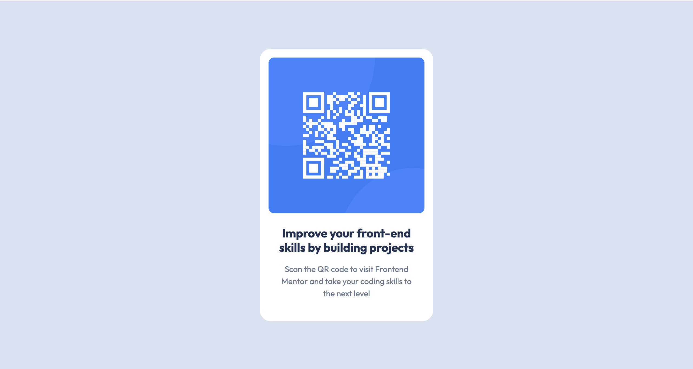

# Frontend Mentor - QR code component solution

This is a solution to the [QR code component challenge on Frontend Mentor](https://www.frontendmentor.io/challenges/qr-code-component-iux_sIO_H). Frontend Mentor challenges help you improve your coding skills by building realistic projects.

## Table of contents

- [Overview](#overview)
  - [Screenshot](#screenshot)
  - [Links](#links)
- [My process](#my-process)
  - [Built with](#built-with)
  - [What I learned](#what-i-learned)
  - [Useful resources](#useful-resources)
  - [AI Collaboration](#ai-collaboration)
- [Author](#author)

## Overview

### Screenshot



### Links

- Solution URL: https://github.com/LU-Joanne/QR-code-component-solution
- Live Site URL: https://lu-joanne.github.io/QR-code-component-solution/

## My process

### Built with

- Semantic HTML5 markup
- CSS custom properties
- Flexbox

### What I learned

預設模式是content-box，padding（內邊距）會加在 max-width（最大寬度）的外面，導致元件實際渲染的最大總寬度變成 320px（288px + 16px + 16px）。加上 box-sizing: border-box;，瀏覽器就會把 padding 和 border 包含在宣告的寬度內。

```css
.card-content {
  max-width: 288px;
  padding: 0 16px;
  box-sizing: border-box;
}
```

### Useful resources

- [box-sizing - CSS - MDN Web Docs](https://developer.mozilla.org/zh-TW/docs/Web/CSS/Reference/Properties/box-sizing) - This helped me for learn CSS. I really liked this pattern and will use it going forward.

### AI Collaboration

- GitHub Copilot, Google AI Overviews
- debugging, generating boilerplate, guiding me in optimizing my code

## Author

- Website - [Joanne](https://github.com/LU-Joanne)
- Frontend Mentor - [@LU-Joanne](https://www.frontendmentor.io/profile/LU-Joanne)
